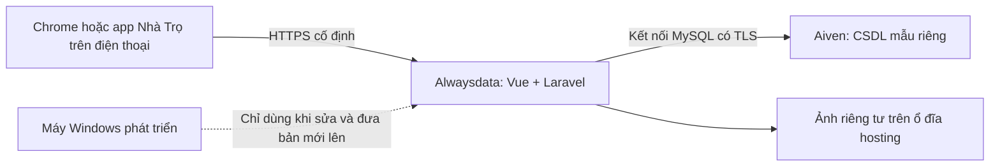

# Kế hoạch chạy web độc lập với máy tính và hoàn thiện cài ứng dụng

Ngày lập: **01/11/2026**. Người dùng ưu tiên **miễn phí để thử trước**, dùng Android/Chrome và đã chọn PWA cài từ website.

**Cập nhật triển khai cùng ngày:** đã tạo tài khoản, kết nối SSH/TLS, triển khai Vue/Laravel và MySQL dữ liệu mẫu tại **https://rentbase.alwaysdata.net/login**. [Hồ sơ bản online và phần còn lại](hosting-rentbase-2026-11-01.md). Những đoạn “chưa triển khai” phía dưới mô tả trạng thái lúc lập kế hoạch; hiện còn bật Scheduled Task, nghiệm thu Android thật và phần trang cài/QR riêng.

## 1. Kết quả cần đạt

1. Có một địa chỉ HTTPS cố định trong thời gian duy trì tài khoản hosting; máy Windows ở nhà tắt hoặc mất mạng thì web vẫn gọi được backend.
2. Cả chủ trọ và người thuê dùng cùng địa chỉ; đăng nhập, phân quyền và nghiệp vụ tiếp tục được Laravel kiểm tra.
3. CSDL và ảnh vẫn còn sau khởi động lại hoặc cập nhật bản chạy.
4. Điện thoại quét QR/mở liên kết, xem hướng dẫn, xác nhận cài và mở biểu tượng Nhà Trọ.
5. Đạt các kiểm tra trên Android thật, đặc biệt sau khi máy tính phát triển đã tắt.

Điện thoại vẫn cần Internet để đăng nhập, lấy dữ liệu và lưu nghiệp vụ. Phần mở lại khung giao diện khi mất mạng đã có; không biến thiết bị thành máy chủ CSDL ngoại tuyến.

## 2. Hiện trạng đã kiểm tra

| Phần | Đã có | Còn cần làm cho hosting |
| --- | --- | --- |
| Frontend | Vue/TypeScript, build Vite; API tương đối `/api` | Phục vụ cùng nguồn HTTPS với backend, sửa đường mở trang trực tiếp |
| Backend | Laravel 12, PHP >=8.2, cookie/CSRF, hai vai trò | Cấu hình môi trường trực tuyến, web root và quyền ghi |
| CSDL chính | MySQL 8.0.43 theo bản chụp; 28 bảng nghiệp vụ, 3 view | Tạo MySQL riêng trên cloud, nạp cấu trúc đầy đủ và dữ liệu giả |
| Migration | Có các migration mở rộng CSDL gốc | Không thể dựng một CSDL rỗng chỉ bằng các migration này |
| Bản thử mobile | Laravel/SQLite/ảnh riêng, Cloudflare Quick Tunnel | Đưa bản chạy sang hosting; không đưa helper SQLite thử nghiệm lên làm máy chủ production |
| Ảnh | Disk `maintenance`, đường riêng tư trong `storage/app/private/maintenance`, tải qua API có quyền | Giữ thư mục ảnh bền vững khi thay bản code; thử backup/restore |
| PWA | Manifest/icon/nút cài, worker lưu khung công khai, trạng thái mạng, cập nhật có xác nhận | Nguồn HTTPS cố định, trang cài dễ tìm, QR/chia sẻ và nghiệm thu cài thật |
| Nhắc hóa đơn | Lịch `rental:remind-invoices --overdue` lúc 08:00 theo múi giờ ứng dụng | Bật scheduled task trên hosting; không phụ thuộc CMD trên Windows |

Kết quả cục bộ hiện có: 94 kịch bản Chrome, 131 unit frontend, 31 bước PWA runtime, 29 bước cài và 69 bước HTTPS. Các kết quả này chưa thay thế nghiệm thu môi trường hosting mới hoặc cài trên điện thoại thật.

## 3. Phương án miễn phí đề xuất

### Chọn Alwaysdata Free + Aiven for MySQL Free

- **Alwaysdata Free:** chạy PHP/Laravel, phục vụ bản Vue tĩnh và lưu ảnh. Trang gói hiện niêm yết 0 EUR/tháng, 1 GB SSD, RAM 256 MB, CPU 1/4 và ba ngày backup. Dùng địa chỉ tài khoản `alwaysdata.net` để thử, chưa cần mua tên miền. [Thông tin gói chính thức](https://www.alwaysdata.com/en/offers/).
- **Aiven MySQL Free:** giữ MySQL, giảm việc đổi hệ quản trị. Gói hiện công bố 1 CPU, 1 GB RAM, 1 GB đĩa, có backup và không yêu cầu thẻ để đăng ký. Có giới hạn sử dụng và có thể bị tắt khi không hoạt động. [Điều kiện gói MySQL Free](https://aiven.io/docs/products/mysql/concepts/mysql-free-tier).
- Kết nối MySQL ra ngoài được kiểm tra ở bước đầu; Alwaysdata công bố các cổng kết nối đi ra không bị lọc, và Laravel đã có biến CA cho MySQL. [Chính sách mạng Alwaysdata](https://help.alwaysdata.com/en/docs/technical-specifications/network/).

Kiến trúc này đã được triển khai theo hồ sơ bản online liên kết ở đầu tài liệu. Kết nối TLS, schema, ảnh và PDF đã được thử trên hosting thật; chưa có kết quả đo tải nhiều người dùng. RAM 256 MB/CPU 1/4 được dùng cho bản demo nhỏ.

### Giới hạn cần tính vào lựa chọn

- Alwaysdata Free phục vụ nhu cầu cá nhân/phi thương mại, chỉ cho địa chỉ tài khoản `alwaysdata.net`, có giới hạn tài nguyên và yêu cầu duy trì hoạt động quản trị. Tài khoản mới cần đăng nhập quản trị ít nhất mỗi 120 ngày theo chính sách hiện tại. Bản đầu chỉ đưa dữ liệu giả của khóa luận lên. [Điều kiện miễn phí và đình chỉ](https://help.alwaysdata.com/en/docs/admin-billing/profile/suspension/).
- Aiven Free không có SLA như gói trả phí; đọc thông báo của nhà cung cấp nếu dịch vụ ít hoạt động. Giữ thêm bản sao ngoài tài khoản cloud.
- Chưa cam kết độ trễ, độ sẵn sàng 24/7 hay khả năng cài trên mọi mẫu Android. Nghiệm thu ở các bước dưới quyết định có đạt nhu cầu thử hay cần thay gói.

### Phương án thay thế khi không đạt

| Phương án | Khi cân nhắc | Việc phải kiểm tra |
| --- | --- | --- |
| Alwaysdata + MariaDB có sẵn | Muốn dùng một tài khoản và chấp nhận kiểm tra tương thích | Host public dùng MariaDB, trong khi CSDL hiện là MySQL 8 có collation/cột sinh/view. Cần import và kiểm thử trên CSDL sao chép; không tự đổi CSDL chính |
| Render Free + MySQL/ảnh bên ngoài | Alwaysdata không đáp ứng hoặc không đăng ký được | Render ngủ sau 15 phút không có truy cập, khởi động lại khoảng một phút; ổ đĩa không bền. Phải có MySQL và nơi lưu ảnh ngoài, thay cấu hình lưu ảnh và session |
| Hosting/VPS trả phí hoặc tài nguyên trường | Cần dùng thường xuyên, nhiều người hoặc tài khoản free không đạt | Chọn theo ngân sách và đo tải sau; giữ cấu trúc cùng nguồn và có backup |

[MariaDB trên Alwaysdata](https://help.alwaysdata.com/en/docs/web-hosting/databases/mariadb/) và [giới hạn Render Free](https://render.com/docs/free) là nguồn cho bảng trên. Không chọn Render rồi giữ SQLite/ảnh trên ổ đĩa tạm của nó. Không dùng Postgres thay MySQL chỉ để khớp một gói miễn phí trong đợt này.

## 4. Các bước triển khai, theo đúng thứ tự

### Bước 1 — Tạo tài khoản và kiểm tra khả năng chạy

**Người dùng:** tạo một tài khoản Alwaysdata Free và một dịch vụ Aiven MySQL Free; tự xác minh email và đăng nhập nhà cung cấp. Chọn gói Free, không bật bản dùng thử trả phí hoặc nâng gói ngoài lựa chọn đã chốt.

**Phần mình chuẩn bị/kiểm tra khi triển khai:**

1. Xác định địa chỉ tài khoản HTTPS; chọn tên dễ nhớ vì sẽ được dùng để cài PWA.
2. Kiểm tra PHP >=8.2, extension theo Composer cùng `pdo_mysql`, GD, mbstring, fileinfo và XML cho nghiệp vụ/ảnh/PDF; chạy kiểm tra yêu cầu nền tảng của Composer.
3. Kiểm tra SSH/SFTP, thư mục lưu trữ, hạn mức đĩa, PHP memory/upload và lịch tác vụ.
4. Từ hosting, kết nối Aiven bằng TLS có kiểm tra CA; xác định MySQL version/port/database/quyền tạo bảng và view thực tế.
5. Thử truy cập HTTPS, xử lý ảnh nhỏ và một PDF tiếng Việt trước khi chuyển toàn bộ app.

**Đạt khi:** host chạy được PHP và kết nối MySQL; không cần máy Windows để hai dịch vụ này tồn tại. Nếu không đạt, chọn phương án thay thế trước khi chuyển dữ liệu.

Không cần gửi mật khẩu nhà cung cấp hoặc mã OTP vào chat. Khi triển khai, thông tin kết nối được đặt trong cấu hình riêng ngoài Git/web root hoặc dùng phiên đăng nhập người dùng đã mở.

### Bước 2 — Chuẩn bị gói triển khai của dự án

1. Build Vue với cấu hình cùng nguồn; giữ `/api` và không bật banner/chế độ fixture của bản mobile local trong gói production mặc định.
2. Chuẩn bị Laravel và dependency theo lockfile, tối ưu autoload, kiểm tra phiên bản PHP trên host. Build frontend có thể làm ở máy phát triển để không dùng RAM gói free cho Node.
3. Phục vụ Vue và Laravel trên **cùng một địa chỉ**. `/api/*` và `/up` đến Laravel; đường giao diện về Vue; API lỗi vẫn trả JSON. Trang `/` backend hiện đang là Blade mặc định, cần điều chỉnh phần phục vụ giao diện khi đóng gói.
4. Chỉ thư mục public được mở ra Internet. Không đưa `.env`, log, bản sao, CSDL hoặc thư mục chạy thử `.cache` vào web root.
5. Cấu hình worker `/sw.js` đúng MIME, scope `/`, `no-cache`; manifest revalidate, HTML không giữ cố định. API/ảnh/PDF riêng tư tiếp tục `no-store`.
6. Giữ phiên bản asset đang dùng khi chuyển bản mới, để quy trình chờ cập nhật hoạt động đúng.

**Đạt khi:** gói chạy cục bộ theo cấu trúc phục vụ dự kiến; mở trực tiếp/tải lại `/owner`, `/tenant/invoices/...`, `/login` được, API không bị nhận HTML.

### Bước 3 — Dựng MySQL mẫu và dữ liệu nghiệp vụ

**Điểm bắt buộc:** các migration hiện có mở rộng 16 bảng gốc. Chỉ chạy `php artisan migrate` trên MySQL rỗng chưa tạo được toàn bộ hệ thống.

1. Tạo database cloud riêng để trình diễn; giữ nguyên MySQL `rental_management` ở máy phát triển.
2. Chuẩn bị bản cấu trúc MySQL đầy đủ, gồm bảng/cột sinh/index/khóa ngoại/view; rà tên database, collation và `DEFINER` theo quyền trên cloud.
3. Chọn một cách quản lý baseline nhất quán: nạp cấu trúc hiện tại kèm trạng thái migration, hoặc dựng baseline bảng gốc rồi chạy các migration mở rộng. Không nạp cấu trúc đầy đủ rồi chạy lại tùy tiện các migration đã áp dụng.
4. Viết bộ khởi tạo dữ liệu giả dành cho MySQL cloud bằng nghiệp vụ hiện có; có kiểm tra đúng database/đã gieo mẫu và không tự chạy lại mỗi khi deploy. Không gỡ các guard SQLite của helper kiểm thử để tái sử dụng cho cloud.
5. Tạo mẫu một/nhiều người, phòng trống/bảo trì, hai kỳ hóa đơn đã kết thúc, thu đủ/một phần/quá hạn, chỉ số sẵn sàng, sự cố/ảnh/lịch sử/chi phí và thông báo chung.
6. Xác định tài khoản mẫu. Giữ lựa chọn tài khoản thử hiện có cho dữ liệu giả; tài khoản quản trị vận hành dữ liệu thật được chốt riêng khi có yêu cầu.
7. Đối chiếu số bảng/view/quan hệ, tiền và quyền hai vai trò. Trên mốc hiện tại mong đợi 28 bảng nghiệp vụ/3 view, thêm bảng theo dõi migration; không đưa metadata fixture SQLite vào CSDL nghiệp vụ cloud.

**Đạt khi:** nghiệp vụ tạo/sửa/đọc thật trên MySQL cloud đúng, khởi động lại không gieo trùng hoặc mất dữ liệu.

### Bước 4 — Cấu hình vận hành, ảnh và sao lưu

1. Đặt `APP_ENV=production`, `APP_DEBUG=false`, URL HTTPS và múi giờ `Asia/Ho_Chi_Minh`.
2. Dùng `APP_KEY` riêng của môi trường cloud và giữ ổn định qua các lần deploy. Cookie Secure/session/CSRF phù hợp cùng nguồn; proxy tin cậy theo hạ tầng thực tế.
3. Session/cache/log và `storage/app/private/maintenance` nằm trong vùng được giữ lại giữa các bản phát hành, có quyền ghi đúng; không đưa thư mục ảnh thành đường công khai.
4. Kiểm tra ảnh cũ sau deploy/restart, xóa/thêm ảnh và quyền truy cập. Hạn mức request/PHP phải tương ứng giới hạn tối đa 5 ảnh x 5 MB hiện có; nếu host hạn chế hơn phải sửa hướng dẫn và kiểm thử tương ứng.
5. Thử PDF tiếng Việt và PDF nhiều trang dưới giới hạn RAM/CPU; giảm tải hợp lý hoặc chuyển gói nếu không đạt, không coi build cục bộ là bằng chứng PDF trên host đã đạt.
6. Bật lịch chạy Laravel trên hosting để nhắc quá hạn lúc 08:00; xác nhận múi giờ/tần suất/log và khả năng chống trùng. Ứng dụng hiện dùng queue đồng bộ, chưa bắt buộc tạo worker chạy thường trực.
7. Sao lưu MySQL, ảnh và cấu hình khôi phục cần thiết; phục hồi thử vào vùng riêng. Giữ bản sao ngoài dịch vụ để có đường quay lại.

[Scheduled Tasks](https://help.alwaysdata.com/en/docs/web-hosting/tasks/) và [HTTPS tự động](https://help.alwaysdata.com/en/docs/web-hosting/sites/ssl-tls/lets-encrypt/) của Alwaysdata hỗ trợ các bước tương ứng; vẫn cần xác minh cấu hình thực tế trong tài khoản.

**Đạt khi:** đổi bản code/khởi động lại không mất ảnh, phiên hoạt động đúng và bản sao khôi phục được đối chiếu.

### Bước 5 — Hoàn thiện đường cài ứng dụng trên điện thoại

Tận dụng manifest/icon/worker và hộp cài đã có. Bổ sung:

- Trang **Cài ứng dụng** dùng chung, mở được từ đăng nhập và giao diện hai vai trò, có URL dễ chia sẻ như `/install`.
- QR dẫn đến địa chỉ HTTPS cố định và nút sao chép/chia sẻ liên kết. QR không chứa mật khẩu hoặc token đăng nhập; ẩn hướng dẫn QR không dùng được khi chỉ đang mở localhost.
- Android: mở Chrome, có nút cài khi trình duyệt cung cấp sự kiện; nếu chưa có thì chỉ đúng menu Chrome và bước xác nhận.
- iPhone: mở Safari, Chia sẻ, Thêm vào màn hình chính và tùy chọn mở dạng web app khi có.
- Nhận biết đang mở dạng ứng dụng để không tiếp tục nhắc cài; hủy/lỗi vẫn giữ khả năng dùng website. Chỉ báo đã cài sau tín hiệu phù hợp hoặc mở thật từ biểu tượng.
- Hướng dẫn cài lại từ địa chỉ hosting mới nếu người dùng từng cài từ `trycloudflare.com`. Ứng dụng cài ở nguồn cũ không tự chuyển sang nguồn mới.
- Giữ tên/icon/manifest ID/scope thống nhất trên **nguồn mới cố định**; các lần phát hành tiếp theo dùng cơ chế cập nhật có xác nhận.
- Giải thích ngắn rằng app vẫn cần Internet cho dữ liệu/nghiệp vụ và thông báo khi đóng app chưa phải Web Push.

**Đạt khi:** người dùng từ máy tính quét QR hoặc mở liên kết trên điện thoại, làm theo hướng dẫn và mở lại được Nhà Trọ từ biểu tượng. Chrome có thể cho WebAPK hoặc lối tắt theo môi trường thiết bị; cần ghi nhận cách mở thực tế, không chỉ nhìn thấy nút cài. [Hướng dẫn Google Chrome](https://support.google.com/chrome/answer/9658361?co=GENIE.Platform%3DAndroid&hl=vi), [hành vi cài Chromium](https://chromium.googlesource.com/chromium/src/+/lkgr/docs/webapps/README.md).

### Bước 6 — Nghiệm thu độc lập với máy Windows

| Ca bắt buộc | Kết quả phải đạt |
| --- | --- |
| Tắt máy Windows hoặc ngắt mạng Windows, dùng điện thoại 4G | Web vẫn gọi API/đăng nhập và lưu thay đổi trên cloud; không chỉ mở được giao diện đã cache |
| Hai vai trò | Vào đúng khu vực; API chủ trọ bị chặn với người thuê; đăng xuất/hết phiên không giữ dữ liệu tài khoản cũ |
| Cài và mở lại | Có biểu tượng, ghi nhận mở độc lập hay tab; đóng/mở lại không dùng URL tạm cũ |
| Camera/chọn ảnh | Quyền thiết bị, xem trước, giới hạn, upload và mở lại ảnh đều đạt |
| PDF | Tải và mở trên Android; sau thu tiền/sửa sai vẫn đúng số dư và trạng thái |
| Khởi động lại/deploy hosting | CSDL, ảnh và tài khoản được giữ |
| Mất mạng giữa thao tác | Bản chờ giữ nguyên; có mạng lại không tự gửi; gửi lại có xác nhận không ghi trùng |
| Bản mới | Để sau được; tab/bản nhập/giao dịch chờ chặn cập nhật; cập nhật an toàn xong vẫn vào được |
| Khôi phục | Dữ liệu, số dư và ảnh khớp bản sao |
| Tài nguyên gói free | Ghi thời gian tải/PDF và lỗi tài nguyên; sử dụng thử hai vai trò đồng thời |

Ghi mẫu máy, phiên bản Android/Chrome và kết quả. Chỉ đánh dấu triển khai độc lập đạt sau ca đầu tiên. Dùng dữ liệu giả cho mọi khoản thu/thông báo/thao tác kiểm tra.

### Bước 7 — Bàn giao và duy trì

1. Gửi URL cố định, trang cài/QR, tài khoản thử và hướng dẫn có ảnh.
2. Ghi nhà cung cấp, gói, địa chỉ, phiên bản code/schema, đường dữ liệu, mốc backup và cách quay lại bản trước.
3. Hướng dẫn duy trì tài khoản miễn phí, xem thông báo dung lượng/không hoạt động và sao lưu định kỳ. Không dùng thủ thuật phát lưu lượng để vượt chính sách gói free.
4. Giữ bản trình cục bộ làm dự phòng cho buổi giảng viên xem; việc Windows tắt không ảnh hưởng bản cloud đã nghiệm thu.
5. Sau đánh giá mới cân nhắc tên miền riêng/gói trả phí, Web Push hoặc ứng dụng cửa hàng nếu cần. Hợp đồng ngoài phạm vi; quên mật khẩu vẫn hoãn theo lựa chọn trước.

## 5. Thứ tự hành động ngay sau kế hoạch

1. Người dùng tạo **Alwaysdata Free** và **Aiven MySQL Free**; xác nhận đã tạo được tài khoản/dịch vụ, chưa cần mua tên miền.
2. Mình chuẩn bị gói deploy/cách phục vụ cùng nguồn và baseline MySQL + dữ liệu mẫu; không thay bản Quick Tunnel đang dùng trong bước chuẩn bị.
3. Đưa lên host, kiểm tra lưu dữ liệu/ảnh và quyền trước.
4. Hoàn thiện trang cài/QR/hướng dẫn bằng URL thật.
5. Người dùng cài trên Android và làm ca tắt Windows; sau đó chốt bàn giao.

Bản online hiện dùng **https://rentbase.alwaysdata.net/login** và không phụ thuộc máy Windows. Các bước trên giữ thứ tự triển khai ban đầu; xem hồ sơ bản online để phân biệt phần đã kiểm tra, Scheduled Task chưa bật và nghiệm thu điện thoại thật còn lại. Bản Quick Tunnel cũ vẫn là môi trường riêng phụ thuộc Windows.
