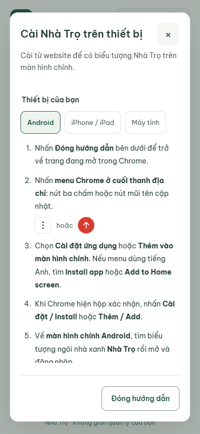
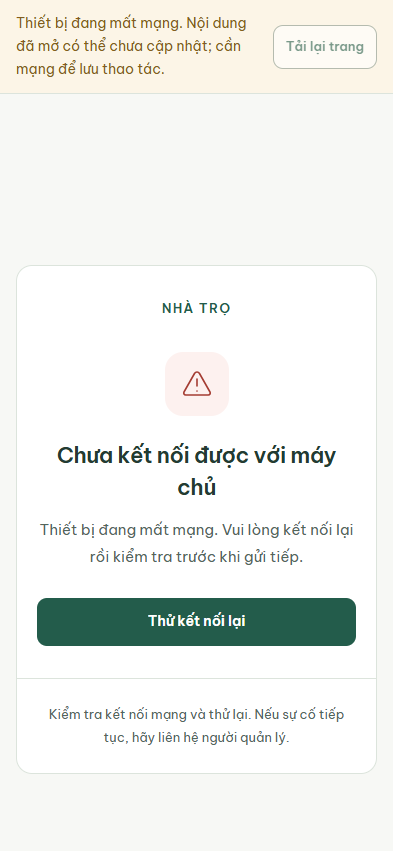
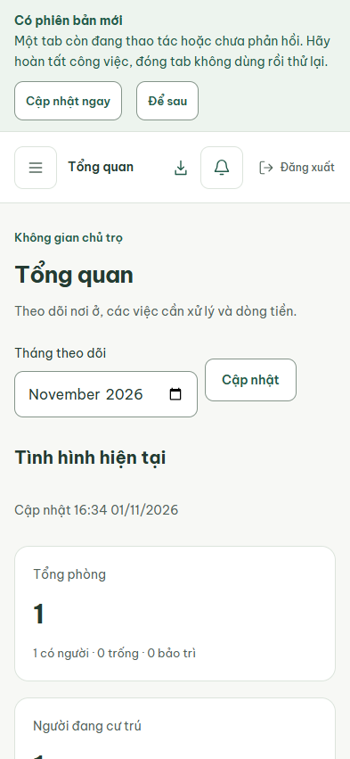

# Cài và sử dụng Nhà Trọ trên điện thoại Android

Ngày bàn giao: **01/11/2026**, cập nhật hướng dẫn **06/11/2026**. Cài trực tiếp từ website bằng Chrome; không cần tải APK hoặc tài khoản cửa hàng ứng dụng.

Đã có [kết quả kiểm thử Chrome mô phỏng điện thoại ngày 06/11](../../docs/chrome-mobile-acceptance-2026-11-06.md): 41 kịch bản chính, 61 điểm bản online và 31 điểm PWA đạt. Kết quả này chưa thay cho các kiểm tra trên Android thật ở phần 8.

## 1. Mở đúng địa chỉ

Trên điện thoại, mở **Chrome ở cửa sổ thông thường** và vào **https://rentbase.alwaysdata.net/login**. [Bản online và hướng dẫn hosting](../../docs/hosting-rentbase-2026-11-01.md).

Bản online chạy trên hosting, máy Windows không cần tiếp tục bật. Điện thoại cần Wi-Fi hoặc dữ liệu di động. Nếu dùng lại bản Quick Tunnel cục bộ ở phần 7 thì riêng bản đó vẫn cần Windows đang chạy.

## 2. Cài lên màn hình chính

Nếu trong hướng dẫn có nút **Cài trên thiết bị này**, nhấn nút đó rồi xác nhận trong hộp cài của Chrome.

Nếu chỉ thấy phần hướng dẫn, thực hiện từng bước:

1. Nhấn **Đóng hướng dẫn** để trở về trang đăng nhập.
2. Nhấn **menu Chrome ở cuối thanh địa chỉ**. Nút này thường là ba chấm; trong ảnh BlueStacks người dùng gửi ngày 06/11, nó là **nút tròn đỏ có mũi tên hướng lên ở góc trên bên phải**.
3. Tìm **Cài đặt ứng dụng / Install app** hoặc **Thêm vào màn hình chính / Add to Home screen**. Có thể cần cuộn xuống trong menu. Một số phiên bản đặt mục cài bên trong **Cài đặt và tạo lối tắt / Install and create shortcut**, khi đó mở mục này rồi chọn **Cài đặt / Install**.
4. Trong hộp xác nhận của Chrome, nhấn **Cài đặt / Install** hoặc **Thêm / Add**, theo lựa chọn được hiển thị.
5. Về màn hình chính Android hoặc danh sách ứng dụng, tìm biểu tượng ngôi nhà xanh **Nhà Trọ**, rồi mở.

**Riêng BlueStacks:** nút về màn hình chính là hình ngôi nhà trên **thanh BlueStacks màu tím**, cạnh mũi tên quay lại. Hướng dẫn trên website chỉ hướng dẫn thao tác; việc cài hoàn tất phải được kiểm tra bằng biểu tượng có thể mở lại trên Android.

Không dùng cửa sổ ẩn danh để thử cài. [Hướng dẫn Google Chrome](https://support.google.com/chrome/answer/9658361?co=GENIE.Platform%3DAndroid&hl=vi).

Nếu đang mở trong trình duyệt bên trong Zalo/Facebook, chọn mở bằng Chrome rồi thực hiện lại. Không thấy mục cài thì vẫn dùng được website trong Chrome; ghi lại phiên bản Chrome/Android để đối chiếu.

Ảnh dưới là giao diện ứng dụng do Chrome mô phỏng kích thước điện thoại; hộp cài và menu hệ điều hành sẽ do điện thoại thật hiển thị.



## 3. Đăng nhập thử hai vai trò

| Vai trò | Tên đăng nhập |
| --- | --- |
| Chủ trọ | `admin` |
| Người thuê | `user` |

Dùng mật khẩu được cấp riêng cho bản online. Bản mobile cục bộ dùng bộ tài khoản và dữ liệu riêng. Chủ trọ vào `/owner`, người thuê vào `/tenant`. Khi mở từ biểu tượng, hãy đăng nhập bằng tài khoản của bản đang dùng nếu được hỏi.

Để đổi vai trò: **Đăng xuất** rồi đăng nhập tài khoản còn lại. Các tab/cửa sổ có thể chia sẻ phiên; muốn thử cùng lúc hãy dùng các hồ sơ hoặc trình duyệt khác nhau.

## 4. Thứ tự tự thử

1. Với `admin`: xem tổng quan, menu phòng, hóa đơn và sửa chữa. **Bản online có hóa đơn kỳ 09/2026 và 10/2026**; chọn đúng kỳ nếu trang đang mặc định tháng 11. Bộ mobile cục bộ cũ tạo ngày 30/10 vẫn có kỳ 08/2026 và 09/2026.
2. Mở hóa đơn, bấm **Tải PDF hóa đơn**. Chrome có thể đưa tệp vào mục tải xuống; mở mục **Tệp đã tải xuống** của Chrome hoặc thông báo tải tệp trên điện thoại để xem/chia sẻ.
3. Mở báo hỏng, xem ảnh và lịch sử xử lý.
4. Đăng xuất, dùng `user`: kiểm tra phòng của tôi, hóa đơn được cấp quyền và báo hỏng.
5. Ở **Báo hỏng → Gửi báo hỏng**, chọn **Chụp ảnh sự cố** để mở lựa chọn camera của thiết bị, hoặc **Chọn ảnh từ thiết bị**. Xem trước, nhập mô tả, bấm xem lại và xác nhận gửi. JPG/PNG/WebP, tối đa 5 ảnh/yêu cầu, 5 MB và 4096 × 4096 px/ảnh. Nếu ảnh không đúng định dạng, chọn ảnh JPG/PNG/WebP khác. Lời mời camera/quyền cụ thể do Android/Chrome điều khiển.
6. Dùng nút quay lại của điện thoại để trở về danh sách; thử xoay ngang và mở bàn phím ở biểu mẫu. Phần này cần đối chiếu trên máy thật.

## 5. Khi mất mạng

Sau lần mở có mạng và chuẩn bị xong, ứng dụng lưu **khung giao diện công khai** để mở lại. Đăng nhập, dữ liệu mới, ảnh/PDF và thao tác nghiệp vụ vẫn cần máy chủ.

- Đang xem rồi mất mạng: có thông báo; nội dung cũ có thể chưa cập nhật.
- Đóng/mở lại khi mất mạng: thấy trang yêu cầu kết nối; không có bản hóa đơn/hồ sơ được lấy từ bộ đệm service worker.
- Đang xác nhận thu tiền hoặc gửi dữ liệu mà chưa có phản hồi: giữ tab và bản chờ, kết nối lại rồi đối chiếu/gửi lại theo nút trong màn hình. Không mặc định đã thất bại rồi tạo một khoản mới.
- Kết nối trở lại **không tự gửi lại giao dịch**. Với giao dịch có mã chống trùng, giữ nguyên bản chờ để kiểm tra lại.



## 6. Khi có phiên bản mới

Thông báo **Có phiên bản mới** cho phép **Để sau**. Nhấn **Cập nhật ngay** sau khi hoàn tất công việc.

Ứng dụng sẽ kiểm tra các tab cùng địa chỉ. Tab đang gửi yêu cầu, còn biểu mẫu/ảnh chưa lưu, menu/hộp thoại đang mở hoặc giao dịch chờ đối chiếu sẽ chặn cập nhật. Hoàn tất/đối chiếu, đóng tab không dùng rồi thử lại. Khi các tab đều an toàn, chúng cùng mở lại; không tự bỏ bản nhập để nâng phiên bản.



## 7. Địa chỉ thử tạm và chạy lại

Cloudflare Quick Tunnel cần máy tính/tiến trình đang chạy và có thể đổi tên miền ở mỗi lần mở lại. **Biểu tượng đã cài từ URL cũ sẽ không tự chuyển sang URL mới.** Nếu đổi địa chỉ, gỡ biểu tượng cũ rồi cài từ liên kết mới. Muốn dùng lâu dài cần hosting và địa chỉ HTTPS cố định.

Nếu cần tự mở lại bản thử, dừng bản cũ trước rồi chạy trong CMD:

```bat
cd /d D:\KLTN\frontend
set "PHP_BINARY=C:\xampp\php\php.exe"
npm run mobile:https
```

Giữ cửa sổ đó chạy; **Ctrl+C** để dừng. Cổng đang dùng có nghĩa có bản đang mở, không cần tắt MySQL. Nếu chưa có công cụ HTTPS, chạy `npm run mobile:https:setup` một lần trước lệnh chạy.

Khi đã dừng bản mobile, `npm run mobile:checkpoint` tạo mốc mã nguồn/build/CSDL/ảnh và kiểm tra khôi phục vào thư mục riêng dưới `.cache/mobile-checkpoints/`. Không dùng lệnh khôi phục của bản trình 5175 cho bản mobile. Không đưa thư mục sao lưu hoặc thông tin truy cập riêng lên GitHub.

## 8. Ghi kết quả điện thoại thật

| Mục | Kết quả người dùng ghi |
| --- | --- |
| Mẫu điện thoại / Android / Chrome | Chưa ghi |
| Có biểu tượng, mở dạng ứng dụng | Người dùng xác nhận đã cài bản hosting trên Android ngày 02/11/2026; chưa ghi nhận chế độ mở từ biểu tượng |
| Đăng nhập và đăng xuất hai vai trò | Chưa đối chiếu trên thiết bị thật |
| Camera/chọn ảnh/xem lại/gửi thành công | Chưa đối chiếu camera thật |
| Mở PDF tải về | Chưa đối chiếu trình xem PDF trên máy |
| Bàn phím, nút quay lại, xoay ngang | Chưa đối chiếu trên thiết bị thật |
| Mở lại lúc mất mạng, kết nối lại | Chưa đối chiếu trên thiết bị thật |

Kiểm thử Chrome tự động không thay thế các thao tác này. [Hướng dẫn Safari iPhone](pwa-install-self-test.md), [kế hoạch và phạm vi PWA](../../docs/pwa-mobile-plan-2026-10-30.md).
